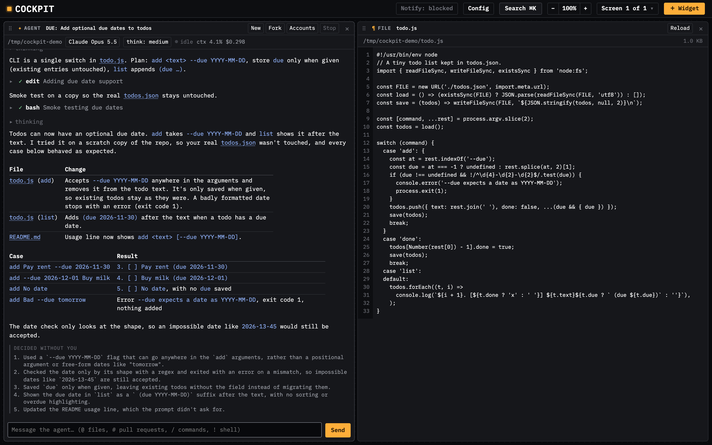

# Cockpit

**A modular, in-browser workbench for coding agents.**

Cockpit runs coding agents from a local daemon and shows them in your browser, and
optionally on your phone; each Agent window runs [omp](https://omp.sh). Everything is a window:
chats, past sessions, notes, pull requests and files are widgets you drag, split, stack and
resize on a snapping grid, as many as you like, side by side.



| Window | What it does |
| --- | --- |
| **Agent** | Chat with an omp agent in a directory (a new window offers the directories of your latest conversations, one click to start there): streamed replies with tables, code blocks (each with a Copy button), math, Mermaid diagrams, Vega-Lite charts and images; tool calls, approvals and questions; model, thinking level and slash commands; steer, stop, rewind or fork. Shows its todo progress and what it has running. `@` mentions files, `#` pull requests, `!` runs a shell command, and `.` alone tells the agent to carry on, as in omp's own editor, without a prompt in the chat; select reply text to comment on it or **Ask** about it. **↑** / **↓** in the title bar (**⌘↑** / **⌘↓**, Ctrl elsewhere) jump to the agent's previous or next reply. `/fork <prompt>` forks the conversation in the background and sends the fork that prompt; dragging **Send** onto the grid forks it into a new window with the message instead. A fork copies the conversation as of the agent's last finished reply, gets a name of its own from its first prompt, and **Forks** lists a conversation's forks and the one it came from; related windows on screen share a colour in their title bars. With *Review decisions* on, each turn lists up to five decisions the agent took without you. Paths and pull requests in replies open with a click or drag out as windows. |
| **Sessions** | Every conversation in one list, with how each is doing (working, *done*, *needs you*); search in plain words, sort, narrow to a directory. Click or drag one into an agent window; archive, restore, pin or mark unread. |
| **Spotlight** | **⌘K** (Ctrl+K) anywhere: the same search, floating; Enter shows the conversation. |
| **Notes** | Markdown notes with inline screenshots and files, kept in `~/.cockpit/scratchpads/`. |
| **Pull request** | A GitHub pull request beside its agent: description, conversation and diff with line comments. Comment on or ask about highlighted parts and send them to the agent as one review; **Bugbot** sends it Cursor Bugbot's findings. The list colours open and draft pull requests and filters by status and author. |
| **File** | A Markdown, JSON, text or code file with line numbers, opened from a path in a reply (at the line it names); Markdown shows rendered. |
| **Setup** | What this machine needs before a first agent, checked live: omp, a model provider (sign in through omp's login from the window), the agents' browser, GitHub's CLI, your phone (optional) and the daemon's switches. Opens by itself on a machine not set up yet. |

A window whose agent finished or asks something while you looked away gets a blue border and
stays unread, everywhere, until you click or type in it. **Notify** in the top bar adds desktop
notifications.

**Config** in the top bar holds the switches. Per browser: *Only prompts and responses* hides
the agent's work in between; *Animated selection* glides between words as you select. Kept by
the daemon, for every browser:

- *Compact idle conversations* (on): compacts a long conversation just before its prompt cache
  expires. A window dims when that point nears.
- *Review decisions* (off): lists, under each reply, the decisions the agent took without you.
- *I have ADHD* (off): agents answer by the [i-have-adhd](https://github.com/ayghri/i-have-adhd)
  rules.
- *Agents’ browser*: where agents open web pages: a separate Chrome (default), your own, or as
  omp is set up.
- *Phone access* (off): see **Phone** below.

**Screens.** Each browser window is a screen of your workspace, like an extra
monitor: open a second window and it starts empty, with its own panes. Layouts
are kept by the daemon (`~/.cockpit/workspaces/`), so they survive a browser
restart: windows opened again get their screens back, and a reload keeps the
window's screen. The switcher in the top bar (**Screen 2 of 3**) lists every
screen and what it holds; a screen open in no window can be opened in this one
(**Open here**, without stopping its agents) or deleted (its agents keep running too), and **New screen** opens a copy of this one, the same windows showing the same things, in a new tab. Add
`?workspace=<name>` to the address for a separate workspace (lowercase letters,
digits and dashes; the default is `main`). Windows at two different addresses at
once (say `127.0.0.1` and `localhost`) do not see which screens the other has
open.

**Phone.** Read and answer your agents from an Android phone over
[Tailscale](https://tailscale.com). Sign in to Tailscale on the Mac and the phone with the same
account, turn on **Phone access** (in Setup or Config), and scan its QR code once. The phone
gets the Sessions list and one conversation at a time, live: reply, answer questions and
approvals, stop the agent. Nothing is hosted: it works while the Mac is awake and `bun start`
runs, and only your own Tailscale devices get in. The page is plain HTTP inside Tailscale's
tunnel, so in Android's VPN settings turn on **Always-on VPN** and **Block connections without
VPN** for Tailscale.

## Getting started

### 1. Install the programs

- **[Bun](https://bun.sh)** 1.3.14 or later, which runs the daemon and tests.

  ```bash
  curl -fsSL https://bun.sh/install | bash
  ```

- **omp**, the coding agent every Agent window runs. It is **not** a dependency of this
  repo; the daemon runs the `omp` on your `PATH`.

  ```bash
  curl -fsSL https://omp.sh/install | sh   # or: brew install can1357/tap/omp
  ```

- Optional: GitHub's **[gh](https://cli.github.com)**, signed in (`gh auth login`), for pull
  request windows. Without it, everything else works.

### 2. Start the daemon

```bash
git clone https://github.com/CaronSch/cockpit && cd cockpit
bun install   # dev tools and git hooks
bun start     # daemon on http://cockpit.localhost:4777
```

Open the URL `bun start` prints **once**. It carries an access token, which the browser
keeps as a cookie. Cookies and browser storage belong to one address, so the first visit at a
new one (say `cockpit.localhost` after `127.0.0.1`, which still works) needs that printed URL
once more.

### 3. Follow Setup

On a machine that has not been set up, the first screen opens the **Setup** window. Each step
says whether it is done; **Check again** after fixing one in a terminal.

1. **omp**: found, and its version; if not, the command to install it.
2. **A model provider**: agents need one, and omp cannot start a session without one.
   **Sign in…** runs omp's own `omp login` from the window: pick a provider by number (Claude
   Pro/Max, ChatGPT, GitHub Copilot…), finish signing in in the browser tab it opens, and answer
   any code it asks for in the window. Or set an API key (`ANTHROPIC_API_KEY`, `OPENAI_API_KEY`…)
   in the shell that runs `bun start`, and restart it.
3. **Agents’ browser**: where agents open web pages (see Config above). The default keeps
   them out of your own Chrome.
4. **GitHub** (optional): whether `gh` is signed in.
5. **Your phone** (optional): whether Tailscale runs on this Mac; once it does, how to set the
   phone up and the **Phone access** switch with its QR code (see **Phone** above).
6. **Preferences**: the daemon's switches from Config.

Once omp runs with a model, **Start an agent** opens an Agent window: pick a directory (folders
are suggested as you type, from your home folder; Tab completes) and start chatting. From then on
new screens start empty; **＋ Widget → Setup** opens it again. Another provider can be added
later from an agent window's **Accounts** (omp's `/login`).

The daemon listens on loopback only, and also on the Mac's Tailscale address while Phone access
is on (see **Phone** above); it refuses requests from other sites.

| Option | Default |
| --- | --- |
| `--port <n>` / `COCKPIT_PORT` | `4777` |
| `--omp <path>` / `COCKPIT_OMP` | `omp` on `PATH` |
| `--cwd <dir>` / `COCKPIT_CWD` (the directory a new agent window suggests) | your home directory |
| `COCKPIT_STATE_DIR` (token, settings, notes, attachments, workspaces) | `~/.cockpit` |
| `COCKPIT_OMP_SESSIONS` (omp's session files) | `~/.omp/agent/sessions` |
| `--tailscale <path>` / `COCKPIT_TAILSCALE` (Phone access) | `tailscale` on `PATH` |
| `--remote-port <n>` / `COCKPIT_REMOTE_PORT` (Phone access) | the `--port` |

Pass flags through with `bun start --port 4800 --cwd ~/code/app`.

## Develop

```bash
bunx playwright install chromium   # once per machine
bun run typecheck                  # tsc over JSDoc types
bun run test                       # unit suites + daemon against a fake omp
bun run test:e2e                   # Playwright: real app and daemon in Chromium
bun run claude-md:check            # generated part of CLAUDE.md is current
```

No build step: the UI is plain ES modules. Its runtime dependencies are Temml,
which turns agents' TeX math into MathML the browser typesets, Mermaid, Vega
and Vega-Lite, which draw the diagrams and charts agents write (loaded only when a
reply has one), and uqr, with which the daemon draws Phone access's QR code. CI runs all four
checks on every push to `main` and every pull request.

- [`CLAUDE.md`](CLAUDE.md): architecture, conventions, how to add a widget.
- [`RISKS.md`](RISKS.md): deferred risks and when they bite.
